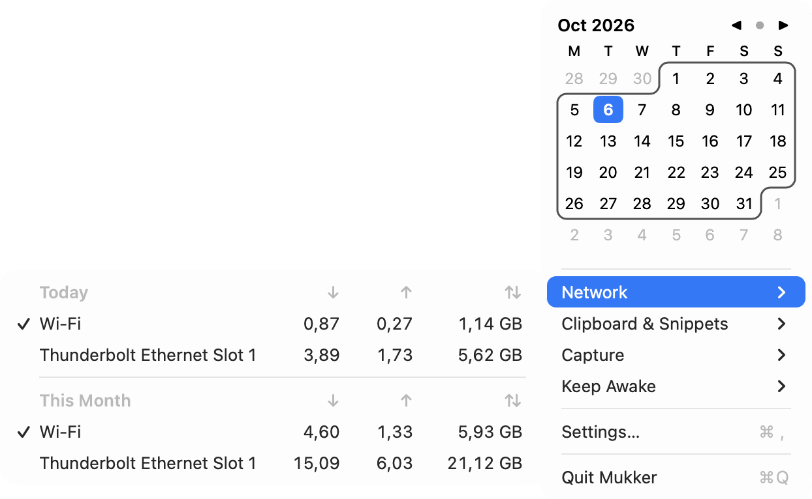
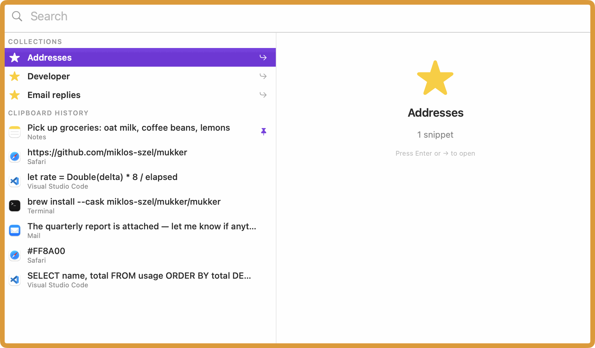
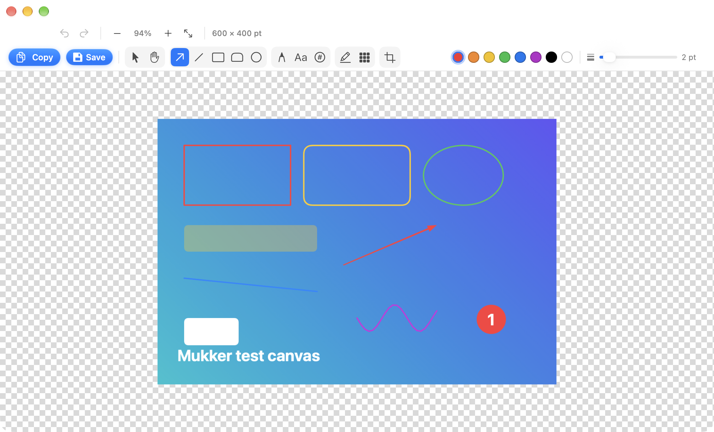
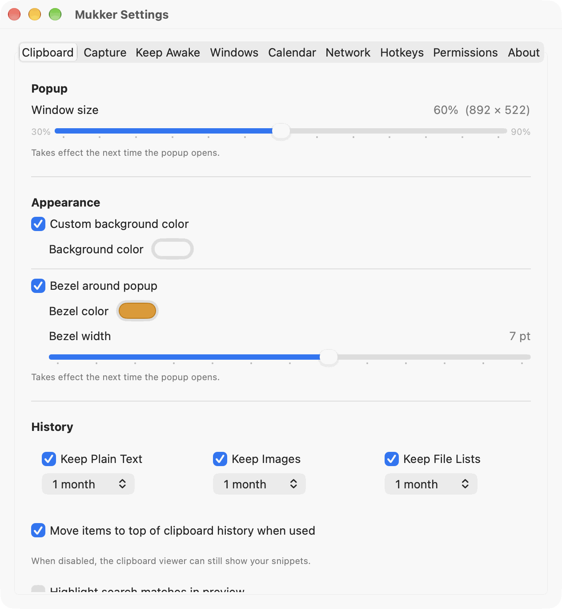
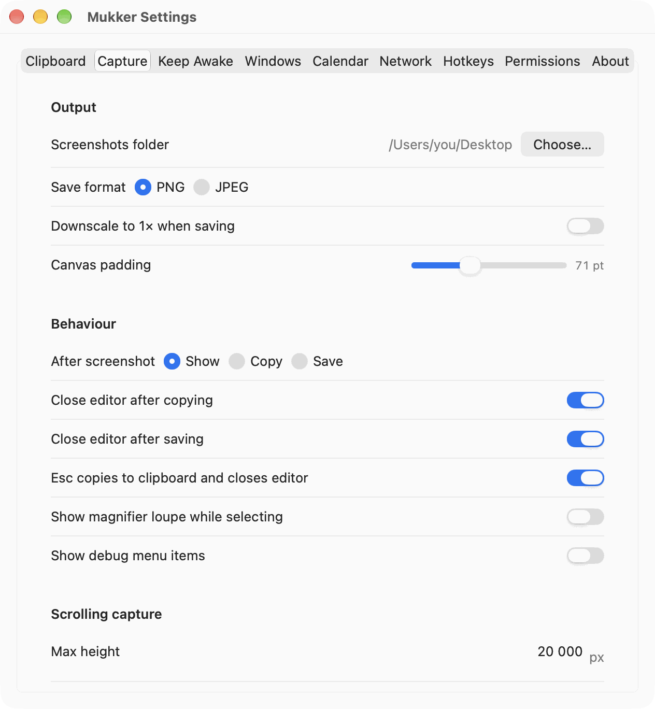
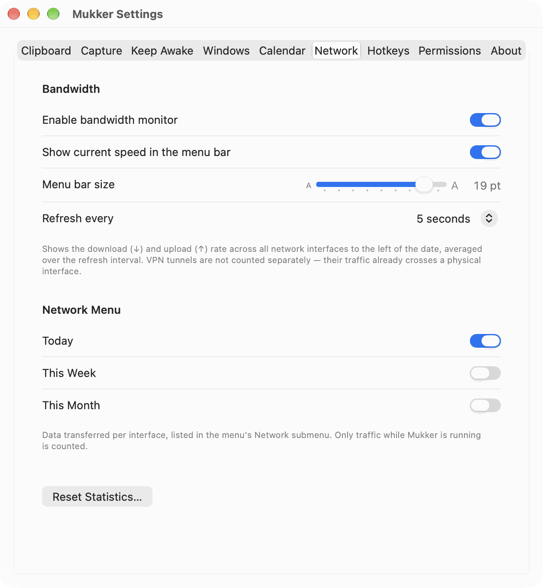
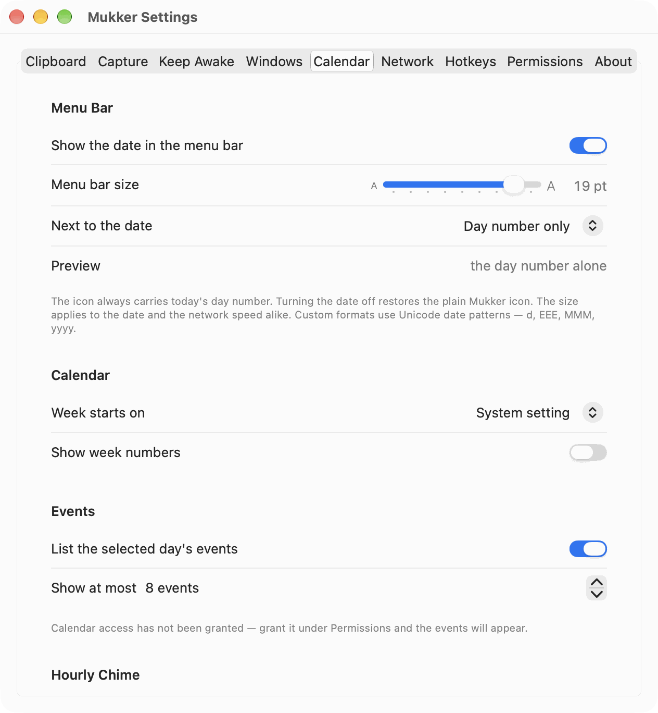
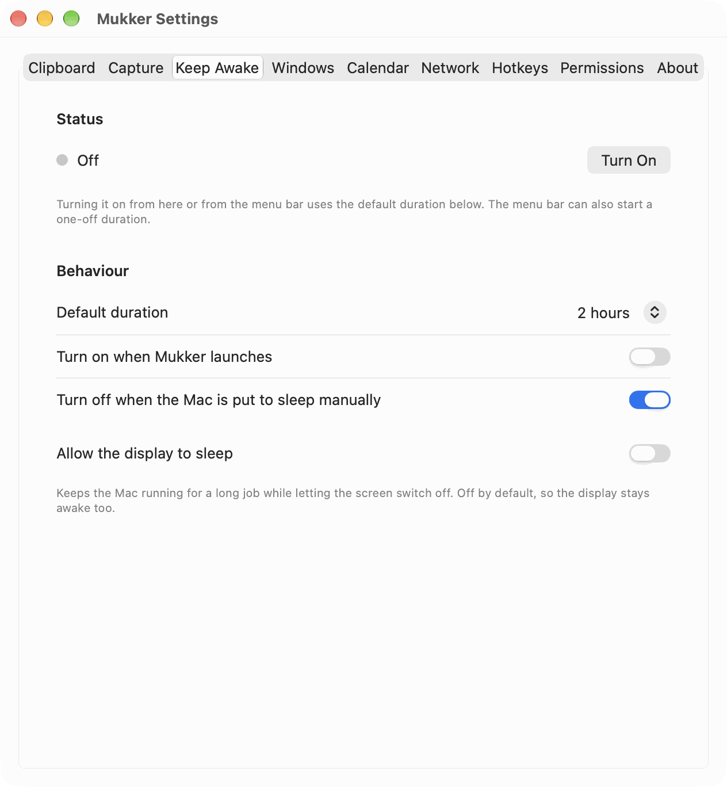
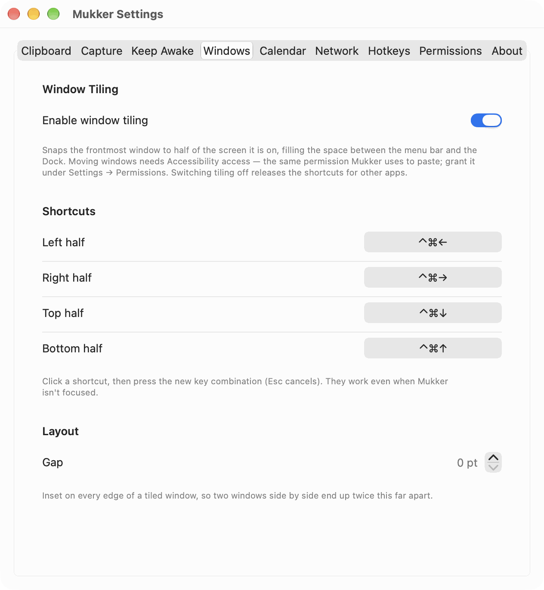
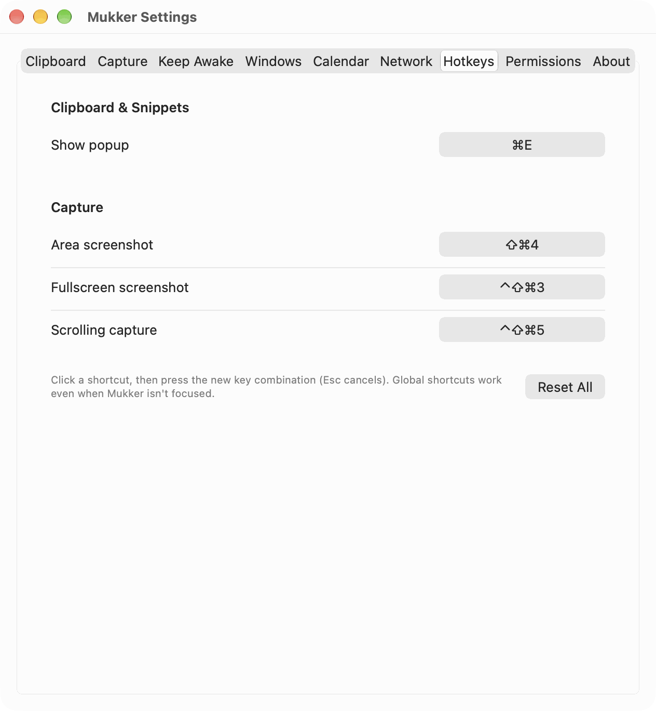

# Mukker

A native macOS menu-bar utility that combines a **calendar**, **clipboard history**, **text
snippets**, **screen capture with annotation**, **window tiling**, a **bandwidth monitor**,
**translation of what you select or copy** and **keeping your Mac awake** in one app. The menu bar shows today's date and drops down a month calendar with the day's
events; a quick popup on a global shortcut pastes back into the app you were just using; a
capture shortcut opens a screenshot in a full annotation editor; a ⌃⌘arrow snaps the frontmost
window to half the screen.

<p align="center">
  
</p>

<p align="center">
  
</p>

## Features

### Calendar

- **Today's date in the menu bar** — the icon is a calendar page carrying the day number, so the
  date is readable at a glance without opening anything.
- **Optionally more beside it** — weekday, month and day, `Sep 2., Wed`, or your own
  `DateFormatter` pattern. Configured in **Settings → Calendar**, with a live preview.
- **A month calendar in the menu** — page back and forward, jump back to today, and pick any day.
  Days that have something scheduled are marked with a dot.
- **The selected day's events** are listed underneath, in their calendar's colour, straight from
  the system calendars. Read-only: Mukker never creates, changes or stores an event.
- **Choose which calendars count** in **Settings → Calendar**; one you subscribe to later is
  included automatically. Needs Calendar access, granted in **Settings → Permissions** — without
  it the calendar still works, just without events.
- **An hourly chime** — a sound at the top of every hour, on whichever output device the Mac is
  currently using. Pick the sound and the hours it runs between in **Settings → Calendar**; a
  range that ends before it starts wraps past midnight. Off by default.

### Clipboard & snippets

<p align="center">
  
</p>

- **Clipboard history** — text (incl. **rich text**/formatting), images, and file lists, with per-kind retention and a max-items cap.
- **Snippets** — organize reusable text into collections; import `.alfredsnippets` snippet bundles and export/import Mukker's own JSON. Names are capped at 100 characters, and oversized imports are refused before they are unpacked (bundles over 10 MB uncompressed or 5,000 entries, Mukker files over 20 MB).
- **Fast popup** (⌘E) — a single searchable list of snippets + history; reads from an in-memory cache so it opens instantly. Press the shortcut again to close. History lazy-loads in pages of 50; search spans everything.
- **Fast append** — double-tap ⌘C to merge the new copy onto the previous text item. It follows the same privacy rules as ordinary capture.
- **Star a clip into snippets** right from the preview — pick a collection (or create one) and name the snippet; the name is prefilled with the clip's first line.
- **Forever history** *(optional, off by default)* — archives text items as `.txt` files before they're deleted.
- **Privacy** — ignores configured apps (password managers preloaded) and respects a max clip size. With *Ignore items marked as concealed/sensitive* on (the default) it also skips copies that apps mark as concealed, transient or auto-generated, copies carrying the 1Password app's marker, and copies from the password-manager browser extensions listed in Settings. Copied HTML is stripped of images, scripts and other remote references before it is turned into rich text, so a copy never makes Mukker load anything. **Clear History…** wipes unpinned items on demand.
- **Screen-relative popup size** (30%–90% of your display) and a **customizable popup appearance** — background color plus a colored bezel with adjustable width.

### Capture & annotation

<p align="center">
  
</p>

- **Area** (⌃⇧⌘4), **fullscreen** (⌃⇧⌘3) and **scrolling** (⌃⇧⌘5) capture.
- **Annotation editor** — arrow, line, rectangle, rounded rectangle, ellipse, text, highlight, blur/pixelate, freehand pen, and numbered counters, with configurable colors, line width and per-tool keys.
- **Crop, movable base image, wheel zoom**, and a checkerboard surround that exports white.
- **Copy or save** as PNG/JPEG, with optional 1× downscaling, a configurable destination folder, and auto-close after copy/save.

### Window tiling

- **Snap the frontmost window to half the screen** with a global shortcut — no clicking, no
  dragging, no animation.
- **Four actions, four shortcuts:** ⌃⌘← left half, ⌃⌘→ right half, ⌃⌘↓ top half, ⌃⌘↑ bottom half.
  All four are rebindable in **Settings → Windows**.
- **Halves fill the space between the menu bar and the Dock**, on whichever display the window is
  already on. An optional **gap** insets tiled windows if you prefer them not to touch.
- **Needs Accessibility access** — the same permission Mukker already uses to paste. Switch tiling
  off in Settings and the ⌃⌘arrow shortcuts are released back to other apps.

### Bandwidth monitor

- **The current network speed in the menu bar**, left of the date — `↓1,1 ↑0,3 Mbps`, the unit
  scaling between Kbps, Mbps and Gbps. A fixed-width badge, so the menu bar doesn't jump around.
- **Refreshes every 5 seconds** by default (1–30 s in **Settings → Network**).
- **Data transferred per interface** — Wi-Fi, Ethernet, Thunderbolt… — in the menu's *Network*
  submenu, with the active interface checked. Today by default; this week and this month can be
  switched on. VPN tunnels aren't counted twice, and only traffic while Mukker runs is recorded.

### Translate

- **Translate what you selected or just copied** — ⌘⇧E into English, ⌘⌥E into Hungarian, ⌃⌘E into German. The
  text selected in the frontmost app is translated; with nothing selected, the newest text in the
  clipboard history is (the source language is detected either way). The result is shown in a
  small floating panel next to the original, marked *from Selection* or *from Clipboard*, and
  copied so you can paste it straight away. Buttons in the panel redo it in another language.
- **A selection is never copied.** It is read through the Accessibility permission, so it doesn't
  replace what is on your clipboard and doesn't appear in the history. Native Mac apps (TextEdit,
  Notes, Mail, …) expose their selection, and Safari pages usually do. Chromium-based browsers
  (Chrome, Brave, Edge, …) and Electron apps (VS Code, Slack, …) work too, though the first press
  in one can take a second or two while it gets ready. Some terminals don't expose a selection,
  and password fields never do — there the shortcut translates the newest clipboard text instead. So does it without the Accessibility permission, and for apps
  you excluded from the clipboard history.
- **The panel is yours to arrange.** Drag it by its header and resize it by its edges (or set
  the size in **Settings → Translate**); it reopens where you left it, with an optional colored
  border like the clipboard popup's. The original text is editable — type or paste more and press
  ⌘↩ to translate again. Esc closes the panel, but not while it holds text you've typed and not
  yet translated; Close or ⌘W discard it.
- **Uses the subscription you already have, no API key.** Mukker hands the text to a command-line
  tool signed in with your own account: the **Codex CLI** for ChatGPT (`brew install codex`, then
  `codex login`) or the **Claude Code CLI** for Claude. Pick the engine, and optionally a model or
  the tool's path, in **Settings → Translate**.
- **Only your selection or what is in your history is ever sent**, and only when you press the
  shortcut — text from ignored apps or marked as concealed never gets there. The text goes to OpenAI or Anthropic
  through that tool and counts against that plan.
- Switch it off in Settings and both shortcuts are released back to other apps.

### Keep awake

- **Stop the Mac idling to sleep** while a long job runs — one click in the menu bar, no Terminal.
- **Timed by default** — an activation lasts **2 hours** and then releases itself, so you can't
  leave the Mac pinned awake by accident. Pick a different length from the *Keep Awake* menu
  (5 minutes through 5 hours, or until you turn it off), or change the default in
  **Settings → Keep Awake**.
- **The menu shows the state** and the time remaining; with the date switched off, the menu-bar
  icon also fills in solid while Keep Awake is on.
- **Optionally let the display sleep** while the machine keeps running, turn it on automatically at
  launch, and have it stand down when you close the lid or sleep the Mac yourself.

Captures copied to the clipboard also land in your clipboard history, so a screenshot you took
five minutes ago is still one ⌘E away.

## Settings

Every feature set has its own tab; Hotkeys, Permissions and About are shared.

| | |
| --- | --- |
| <br>**Clipboard** — popup size and look, history retention | <br>**Capture** — output folder and format, editor behaviour |
| <br>**Network** — menu bar speed, refresh interval, periods | <br>**Calendar** — menu bar date and size, week start, events |
| <br>**Keep Awake** — default duration, sleep behaviour | <br>**Windows** — tiling shortcuts and gap |
| <br>**Hotkeys** — popup and capture shortcuts | |

## Shortcuts

| Key | Action |
| --- | --- |
| ⌘E | Open / close the popup |
| ⌃⇧⌘4 / ⌃⇧⌘3 / ⌃⇧⌘5 | Capture area / screen / scrolling |
| ⌃⌘← / ⌃⌘→ | Tile the frontmost window to the left / right half |
| ⌃⌘↓ / ⌃⌘↑ | Tile the frontmost window to the top / bottom half |
| ⌘⇧E / ⌘⌥E / ⌃⌘E | Translate the selection (or the latest clipboard text) into English / Hungarian / German |
| ↑ / ↓ | Move selection in the popup |
| Return | Paste selected item (with formatting) |
| ⌘⇧V | Paste **without** formatting (plain text) |
| ⌘C | Copy selected item to the clipboard (no paste) |
| → / Return on a collection | Drill in |
| ⌘, | Open Settings |
| Esc | Close |

The popup and capture shortcuts are configurable in **Settings → Hotkeys**; the four tiling
shortcuts live in **Settings → Windows** and the two translate shortcuts in
**Settings → Translate**, each next to the switch that turns them on and off. A new
shortcut has to include ⌘, ⌃ or ⌥ (F1–F20 may be used on their own), since a global shortcut
takes its key away from every other app; one recorded before 1.3.0 without a modifier keeps
working until you record a new one. The calendar has no shortcut — it is the menu bar item itself.

## Where your data lives

Clipboard history and snippets are stored in a SQLite database at
`~/Library/Application Support/Mukker/mukker.sqlite`, with image and rich-text sidecar files
alongside it. The folder is readable by your user account only (folders `0700`, files `0600`;
Mukker tightens an existing folder at launch). Saved screenshots go wherever you point
**Settings → Capture → Screenshots folder**, defaulting to the Desktop, and never overwrite an
existing file — a second save in the same second is numbered (`… 2.png`).

Upgrading from a build older than 0.5.0, which stored its data under a different name? **Nothing is
carried over automatically** — 0.6.0 removed the one-shot migration. The old folder is left
untouched, so you can move the data across by hand: **quit Mukker first** (copying a live SQLite
database risks a corrupt copy), then copy the old database — along with its `-wal`/`-shm` siblings
and the `images/`/`richtext/` sidecar folders — into `~/Library/Application Support/Mukker/`,
renaming the database and its siblings to `mukker.sqlite`. Settings, the popup shortcut and
snippet files exported by those builds are not read any more.
That upgrade path also changed the bundle identifier, so macOS treats this as a new app:
**Accessibility and Screen Recording have to be granted once more** (Settings → Permissions has
buttons for both).

## Permissions

One **Accessibility** grant covers everything that needs it: pasting into the active app,
double-⌘C merging, auto-scrolling during scrolling capture, window tiling, and reading the selected
text to translate (without it, translation uses the newest clipboard text). **Screen Recording** is
additionally required for capture. Both are shown live, with grant buttons, in
**Settings → Permissions**.

## Build / run

The Xcode project is generated from `project.yml` by [XcodeGen](https://github.com/yonaskolb/XcodeGen).
A `Makefile` wraps the common flows:

```bash
make build    # regenerate project + build
make run      # build and launch
make test     # run the test suite
```

SPM dependencies (resolved on first build): GRDB.swift, HotKey, ZIPFoundation.

## Windows version

`windows/` holds a native Windows 10/11 port (.NET 8, WPF): clipboard history + snippets, capture
with annotation, and translate, living in the notification area. It shares the snippet export
format and the history database schema with this app. See [`windows/README.md`](windows/README.md).

## Renaming the app

The product name is not baked into the tree: source directories are `App/` and `AppTests/`,
the `Makefile` reads the scheme out of `project.yml`, and every user-facing name comes from
`App/Support/Branding.swift`.

```bash
make rename NAME=NewName                                 # product name only
./scripts/rename.sh NewName --bundle-id com.me.NewName   # also change the bundle ID
./scripts/rename.sh NewName --repo https://github.com/me/newname
```

It rewrites `project.yml`, `Info.plist`, the docs and (with `--repo`) `Branding.repoURL`, then
regenerates the Xcode project. Nothing moves on disk.

Data locations deliberately do **not** follow a rename — the Application Support folder name, the
database file name, the bundle identifier and the snippet export format string are frozen in
`Branding.swift` so existing databases, permission grants and previously exported files keep
working. The script derives its protect-list from those constants and skips doc lines mentioning
them, so it can't quietly rewrite them. Moving the data identity too is a deliberate, separate
change: update the constant *and* add a migration step that adopts the old value. There is none in
the tree today, so on its own each one costs something different — renaming the folder or the
database file starts the app from an empty history, changing the bundle identifier drops your
settings and permission grants, and changing the export format string makes previously exported
snippet files unreadable.

## Install

Mukker ships ad-hoc-signed (no notarization).

- **DMG** — download from [Releases](https://github.com/miklos-szel/mukker/releases), open it, and drag the app to `/Applications`. On first launch, right-click → **Open** to bypass Gatekeeper.
- **Homebrew** — this repo is its own tap, so point Homebrew at it once and install from it (the cask
  strips the quarantine flag, so no Gatekeeper prompt):

  ```bash
  brew tap miklos-szel/mukker https://github.com/miklos-szel/mukker
  brew install --cask miklos-szel/mukker/mukker
  ```

  Upgrades come with `brew update && brew upgrade --cask mukker`.
